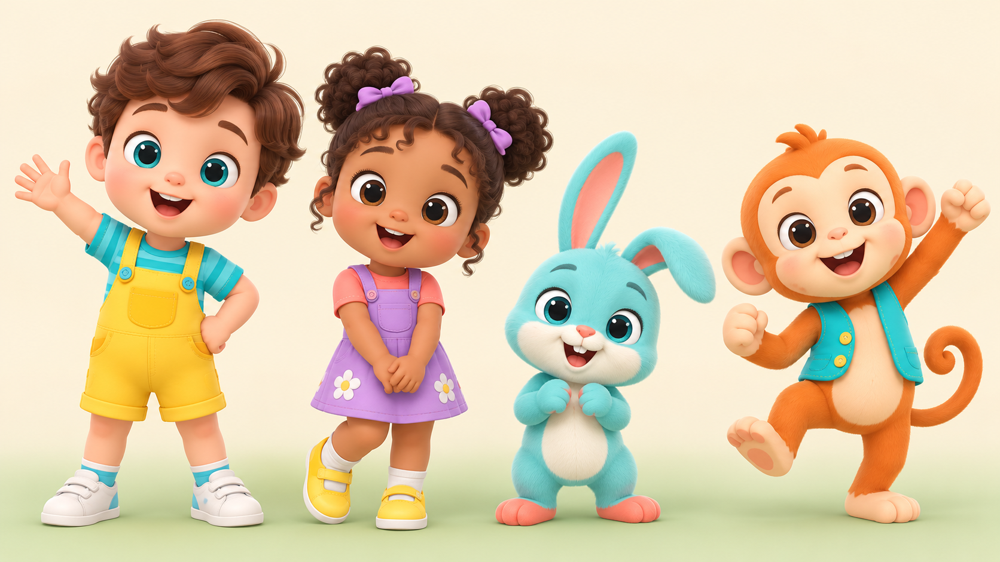

# Nursery Rhymes Video Director

A practical kit for creating original nursery-rhyme videos for YouTube with a recurring cast, timed verses, scene prompts, and a consistent storybook world.

**Channel concept:** Milo & Friends Nursery Rhymes  
**Recurring characters:** Milo, Lila, Pip, and Bubo  
**Full-video format:** 16:9 landscape · 1:30–2:00  
**Shorts:** separate 9:16 portrait cutdowns

[**Install / use the Nursery Rhymes Director Skill**](https://github.com/adniyala0007-bit/nursery-rhyme-video-director/tree/main/skills/directing-nursery-rhyme-videos) · [Open the character sheets](docs/character-sheets.md)

## Install and get started

Use this repository link with an AI assistant that supports installing repository Skills:

`https://github.com/adniyala0007-bit/nursery-rhyme-video-director`

Or open the [Skill folder](skills/directing-nursery-rhyme-videos) directly. After installation, ask the assistant to read `SKILL.md`, the character bible, and the character sheets.

Copy this prompt to start a full episode:

```text
Read skills/directing-nursery-rhyme-videos/SKILL.md, docs/character-bible.md,
docs/character-sheets.md, prompts/environments.md, and prompts/full-episode-video-prompt.md.

Create an original nursery-rhyme song video in 16:9 landscape, 1:30–2:00 total.
Use Milo, Lila, Pip, and Bubo according to their character sheets. Write original,
timed verses that name the characters as they appear. Give me the treatment,
complete lyrics, and a timed storyboard. Every video prompt must state the
active character names, shot duration, 16:9 landscape, and consistency rules.
Choose one approved environment from prompts/environments.md and attach its PNG as the set reference in every shot. Keep the same faces, colors, outfits, proportions, and chosen setting throughout.
```

## Production steps

1. Choose a simple preschool theme and one learning or feeling goal.
2. Write an original verse-and-chorus song, timed to a total of 90–120 seconds.
3. Plan 8–12 gentle shots and match each verse to named characters and actions.
4. Attach the character-sheet references to every image or video generation request.
5. Generate a short visual test, then produce and edit the approved scenes.
6. Review the complete video, captions, sound, safety, and asset rights before publishing.

## Character sheets

These original 3D designs use your images as broad nursery-rhyme style references. The new cast does not reuse the source logos or exact character models.

| Character | Reference sheet |
| --- | --- |
| Milo | [View Milo's three-view sheet](assets/character-sheets/milo-turnaround.png) |
| Lila | [View Lila's three-view sheet](assets/character-sheets/lila-turnaround.png) |
| Pip | [View Pip's three-view sheet](assets/character-sheets/pip-turnaround.png) |
| Bubo | [View Bubo's three-view sheet](assets/character-sheets/bubo-turnaround.png) |



The [character sheet guide](docs/character-sheets.md) explains how to reuse these PNG references consistently. Keep the same model version attached across every episode.

## Repository map

```text
docs/                         Channel, character, and production guides
assets/character-sheets/      3D nursery-rhyme cast lineup and turnaround references (PNG)
assets/environments/          16:9 reusable storybook environment reference plates (PNG)
episodes/                     Timed episode briefs and production packs
prompts/                      Copy-ready image/video/thumbnail prompts
skills/                       Nursery-rhyme video director Skill
scripts/                      Small local productivity tools
templates/                    Blank episode and storyboard templates
```

## Important defaults

- Every full nursery-rhyme video is **16:9 landscape** and **90–120 seconds**.
- Each episode contains named characters and original, timestamped verses.
- Every video prompt names the characters in that shot, or says `On-screen characters: none`.
- Use the same attached character references, outfit colors, proportions, and chosen environment reference in every shot.
- Choose one environment from [prompts/environments.md](prompts/environments.md) for each episode and preserve its layout across scenes.
- Do not render lyrics, captions, logos, or other text inside generated footage; add captions in the editor.
- Full episodes are not Shorts. Make any Shorts cutdown separately in 9:16.

## Copyright and child-directed content

Write new lyrics and melodies for this channel. Do not reproduce protected lyrics, melodies, character designs, logos, or thumbnail compositions from existing channels. Use assets whose licenses permit your intended use, including monetized publishing if applicable. Review YouTube's current audience-setting and child-safety requirements before publishing.

The repository text and scripts are released under the MIT License. This does not grant rights to third-party assets added later.
