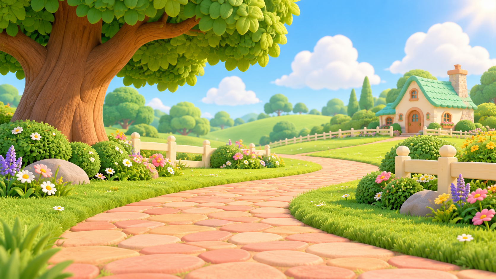
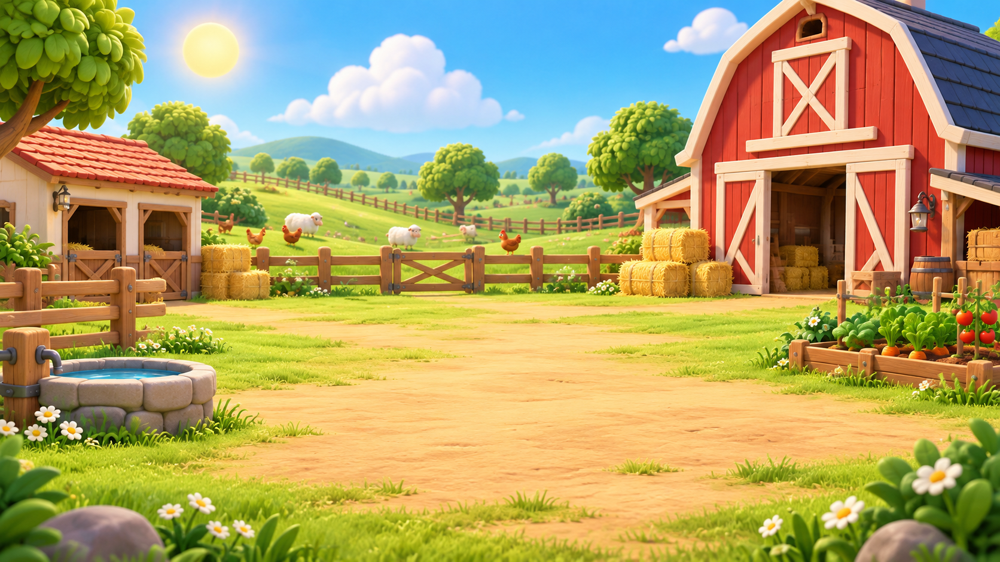
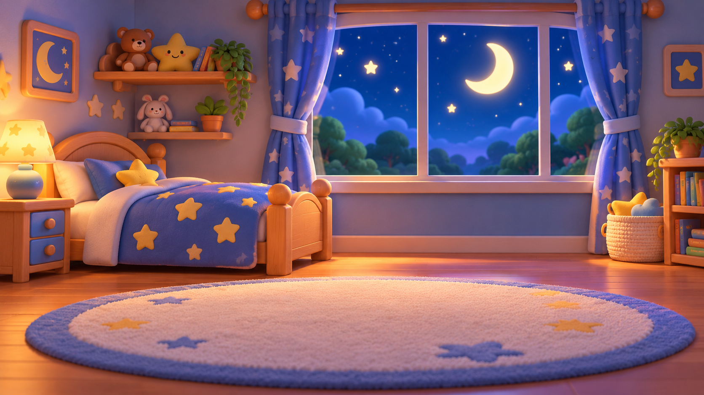
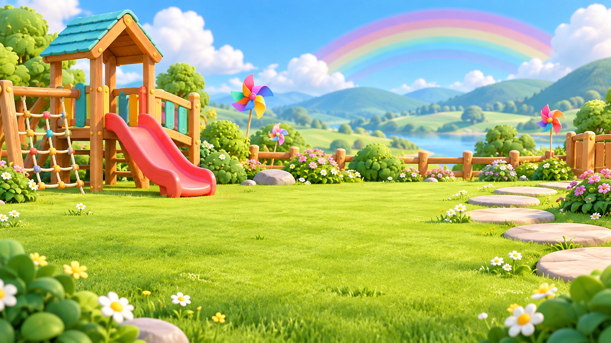

# Environment Bible and Prompts

Five reusable 16:9 storybook locations for Milo & Friends Nursery Rhymes. Each PNG is an environment-only master plate. Add Milo, Lila, Pip, and Bubo later with their separate turnaround references.

## Shared world rules

- Keep the polished, soft 3D preschool storybook finish, rounded shapes, warm light, and bright balanced colors used by the character sheets.
- Select one primary environment for each episode. Peach Stone Garden Lane is the default home setting; choose another location when it supports the song.
- Attach that location's PNG as the set reference in every shot. Preserve its layout, landmarks, palette, perspective, and time of day across shots in the same episode.
- Attach only the character PNG references for the named on-screen cast. Do not redraw or redesign the characters as part of the background.
- Generate full videos in 16:9 landscape. Keep the foreground readable and leave clear room for the named characters to act.
- Do not add titles, lyrics, captions, logos, or watermarks inside generated footage.

## 1. Peach Stone Garden Lane

Default home setting and continuity anchor.

~~~text
Use case: illustration-story. Asset type: reusable 16:9 landscape environment background for a preschool nursery-rhyme video. Create the canonical Peach Stone Garden Lane: a peach-colored stone path curves through emerald meadow grass, with a large rounded oak on the left, pastel flowers, low cream fences, rounded bushes, and a distant cottage with a mint roof. Warm morning sunlight and fluffy white clouds. Polished 3D preschool storybook animation, soft rounded forms, sunny natural light, bright balanced colors, clear readable shapes, open uncluttered foreground for later character animation. Environment only: no people or characters. No text, logos, or watermark.
~~~

## 2. Sunny Farmyard

For animal, counting, and farm-themed rhymes.

~~~text
Use case: illustration-story. Asset type: reusable 16:9 landscape environment background for a preschool nursery-rhyme video. Create a sunny, friendly storybook farmyard with a rounded red barn, small cream stable, tidy wooden fence, hay bales, a water trough, vegetable patch, rolling green hills, and a few small distant sheep and chickens. Bright morning sky and warm soft sunlight. Polished 3D preschool storybook animation, rounded forms, gentle child-friendly details, vivid but balanced colors, clear open central foreground for later character animation. Environment only: no people or main cast characters. No text, logos, or watermark.
~~~

## 3. Cozy Bedtime Bedroom

For lullabies, bedtime routines, and quiet moon-and-star songs.

~~~text
Use case: illustration-story. Asset type: reusable 16:9 landscape environment background for a preschool nursery-rhyme video. Create a cozy child-friendly storybook bedroom at bedtime: a small rounded bed with a star-pattern quilt, moon and stars visible through a wide window, a soft night lamp, plush toy shapes on a shelf, gentle curtains, a rug, and clear open floor. Deep twilight blue balanced with warm amber lamp glow; calm, reassuring mood. Polished soft 3D preschool storybook animation with rounded shapes and gentle colors. Environment only: no people or characters. No text, logos, or watermark.
~~~

## 4. Rainbow Meadow Playground

For movement, weather, colors, and friendship songs.

~~~text
Use case: illustration-story. Asset type: reusable 16:9 landscape environment background for a preschool nursery-rhyme video. Create a cheerful storybook meadow playground with a low wooden play frame, small slide, stepping-stone path, colorful pinwheels, daisies, rounded shrubs, distant hills, and a soft rainbow after a light spring shower. Bright fresh daylight, polished soft 3D preschool storybook animation, rounded shapes, safe age-appropriate playground forms, vivid but balanced colors, clear action-friendly open grass foreground. Environment only: no people or characters. No text, logos, or watermark.
~~~

## 5. Sparkling Seaside Cove

For water, shells, boats, and gentle ocean-themed songs.

~~~text
Use case: illustration-story. Asset type: reusable 16:9 landscape environment background for a preschool nursery-rhyme video. Create a gentle storybook seaside cove with shallow turquoise water, smooth peach-colored sand, rounded rock pools, a small wooden pier, colorful shells, a distant lighthouse, a soft green headland, and fluffy clouds. Sunny sparkling daylight without harsh glare; polished soft 3D preschool storybook animation with rounded forms and a cheerful balanced palette. Calm child-friendly mood and open sand foreground for later character animation. Environment only: no people or characters. No text, logos, or watermark.
~~~

## Reusable scene integration prompt

~~~text
Create a 16:9 landscape nursery-rhyme scene in the attached approved environment reference: [environment name and PNG filename]. On-screen characters: [exact names, or none]. Attach the matching character turnaround PNGs for every named character. Preserve the environment's layout, landmarks, colors, perspective, and lighting, and preserve each character's face, species, hair or fur, outfit, proportions, and scale. Show one clear, gentle action matched to the lyric: [lyric cue and action]. Duration: [shot duration]. Use a stable camera and leave any captions for editing; no text, logos, or watermark.
~~~
